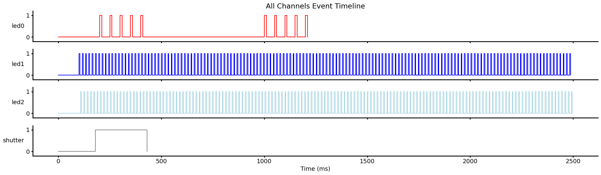
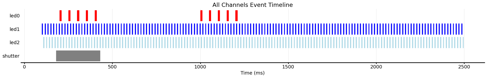

# Docs
- Use Jupyter notebook to design stimulus schedules (see [Configuring schedules](#configuring-schedules))
- copy to microSD card for Teensy
- When server starts a trial, the led_driver Teensy plays every channel's schedule from a shared trial clock and reports each output change back to the server
- If the connection drops, the Teensy turns all LEDs off and then opens the shutter


Example LED schedule:



# Configuring schedules

All timing is set in the config cell of `make_event_array_files.ipynb` (the cell that defines `sd_card_name` and `channels`).

1. Set `sd_card_name`. Files are written to `arduino_sd_cards/<sd_card_name>/`.
2. Edit the `channels` dict (see below). Channel keys must be `led0`, `led1`, `led2` and `shutter` for the Teensy
3. Run all cells. The notebook builds each channel's events, checks them, writes the SD card files, and plots every channel on one timeline. Check the plots before copying.
4. Copy the **contents** of `arduino_sd_cards/<sd_card_name>/` to the root of the microSD card, not the folder itself
5. Reboot the Teensy; reads SD card at startup


The configuration cell in the notebook should look something like:
```python
sd_card_name = "card_test"

channels = {
    "led0": {
        "plotting_color": "red",
        "schedules": [
            {"start_time": 200,
            "stim_duration": 10,
            "off_duration": 40,
            "total_stims": 5},
            {"start_time": 1000,
            "stim_duration": 10,
            "off_duration": 40,
            "total_stims": 5},
        ],
    },
    "led1": {...},
    "led2": {...},
    "shutter": {...},
}
```

| Channel field | Meaning |
|---|---|
| `plotting_color` | color for plotting |
| `schedules` | list of blocks of identical, evenly spaced stims; can be empty |

| Schedule field | Unit | Meaning |
|---|---|---|
| `start_time` | ms | When the first stim turns on, measured from trial start (the `q` message) |
| `stim_duration` | ms | How long each stim stays on |
| `off_duration` | ms | Gap from the end of one stim to the start of the next |
| `total_stims` | count | Number of stims in the block |


# Output files

For each channel, the notebook writes these files to `arduino_sd_cards/<sd_card_name>/`:

| File | Contents |
|---|---|
| `<channel>_event_timesteps.txt` | Number of events, then one event time per line (ms from trial start) |
| `<channel>_event_settings.txt` | Number of events, then one state per line: `1` = on (shutter closed), `0` = off (shutter open) |
| `<channel>_generation_params.json` | The channel's config plus the two file names above. This is a record of how the files were made; the Teensy doesn't read it. |

Also saves `all_channels_timeline.png` and `all_channels_timeline_gantt.png`

Every channel starts with an off event at 0 ms, followed by an on event and an off event for each stim. For example, `led0_event_timesteps.txt` begins `21, 0, 200, 210, 250, …`, and `led0_event_settings.txt` begins `21, 0, 1, 0, 1, …` (one value per line). After its last event, a channel stays off until the next `q` restarts every channel at t = 0

# Reqs
- Teensy 4.1 with the Ethernet kit and a microSD card. LED drivers go on pins 2–4 and the shutter on pin 5.
- [WebSockets_Generic](https://github.com/khoih-prog/WebSockets_Generic) and NativeEthernet libraries. Set `WS_HOST` and `WS_PORT` in `led_driver.ino`, then upload.

# Repo structure
- `led_driver/*`: Teensy code with WS client and trial state machine, SD card loader
- `make_event_array_files.ipynb`: Schedule generator
- `arduino_sd_cards/card_test/`: Example generated schedules
- `utils/graphics.py`: graphics settings

# Networking

| Message | Meaning |
|---|---|
`a` | Start session (LEDs off, shutter open) |
`q` | Start trial (all schedules restart at t = 0) |
`k` | Stop session |
`e` | Connected |
`i` + 4 chars | Output state, sent on every change, in the order shutter, led0, led1, led2. `3` means open or on, `2` means closed or off |

